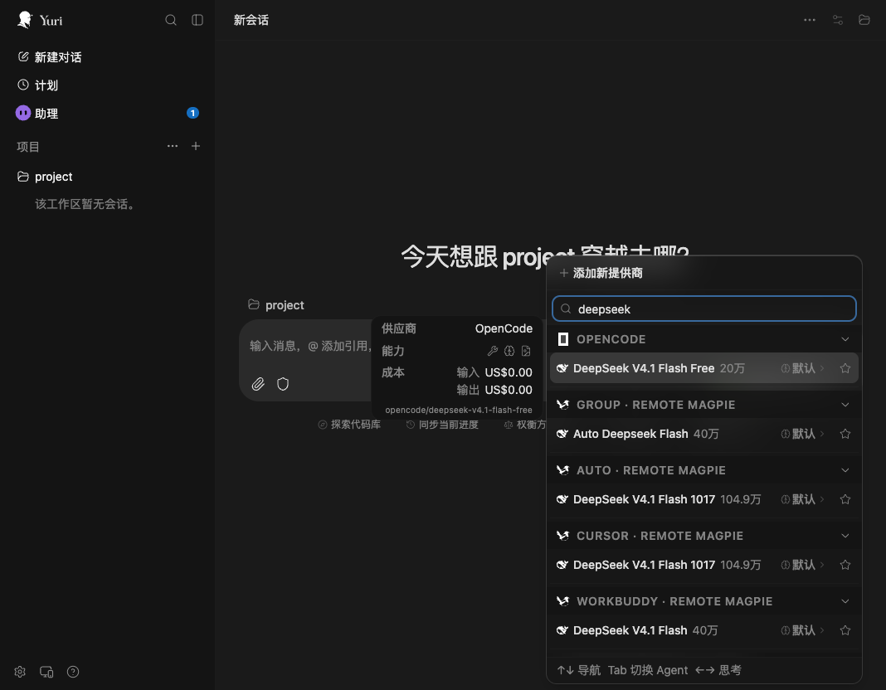
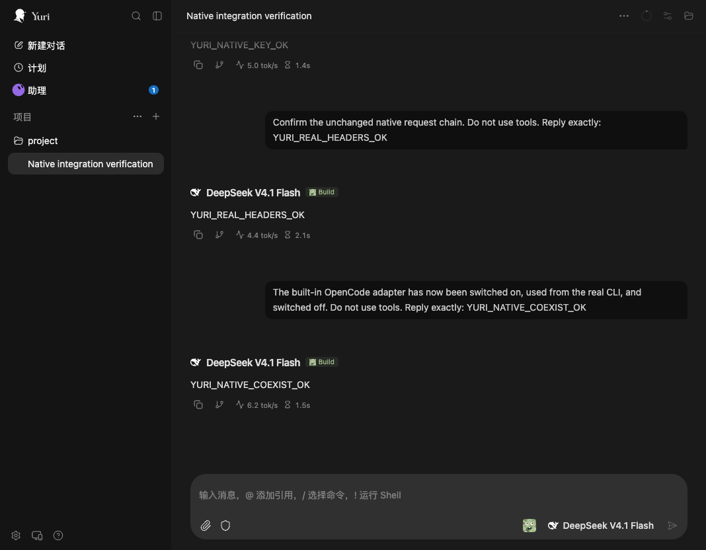
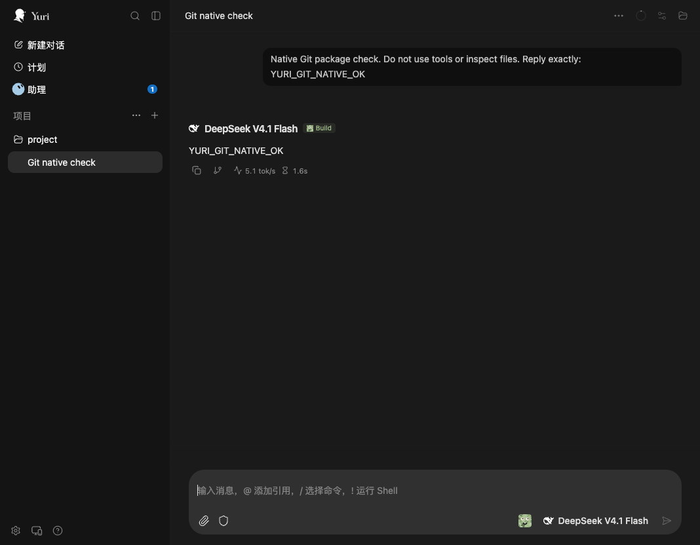

# PR #802 revision verification

Yuri original website: https://useyuri.top.

This document preserves the community PR's native UI/CLI evidence below. Its
`packages/yuri` and `packages/magpie-provider` command paths refer to that
community checkout, not this repository's layout. Here the bridge lives at the
root and the identical corrected provider source/runtime lives in `provider/`.
Unlike the community npm-pin variant, this Git package directly loads its bundled
local provider directory; no community npm publication or manual config
substitution is needed. Local packaging checks are recorded in section 4.

Run on 2026-11-07, macOS arm64, Node 24.18.0, OpenCode 2.2.6,
Magpie 0.1.3014. Yuri Web used the repository's production Web build
(`@yuriai/web` working-tree version 0.2.32-beta.10), not an automated claim
about the Electron UI. All OpenCode/Yuri/Magpie test state used temporary HOME
and XDG directories. The user's running applications/configuration were left
alone. Long-running test services ran in a task-owned tmux session.

## 1. Yuri model listing and real inference

The original attribution run used a generic gateway key and then overwrote the
User-Agent to obtain a Yuri label. That was not evidence of a real integration.
**It has been removed and superseded by the native-contract run below.**

1. Inspect the real cloned Yuri source: `packages/ui/src/lib/opencode/client.ts`
   uses the official session create/prompt boundary, and
   `packages/web/server/lib/opencode/lifecycle.js` owns the external/shared
   service connection. Yuri is an OpenCode client; OpenCode owns model HTTP.
   No Yuri source, bundle, request metadata or upstream OpenCode source was patched.
2. Start an actual sandbox Magpie host with temporary HOME/XDG directories.
   Its built-in Remote Magpie provider points to the already-running gateway,
   so real inference is forwarded by Magpie's native implementation. Install
   this checkout's Agent and run `magpie yuri provider magpie`.
3. Let the actual bridge create the pinned community provider entry. Assert
   `options.remote.token` equals the key in Magpie's generated Yuri sidecar,
   and that it is not the generic key from the superseded test. Do not derive,
   rewrite, append to, replace, or print the assigned key.
4. `npm pack --ignore-scripts --workspaces=false` in `packages/magpie-provider`
   and extract it. Because npm first publication is pending, change **only the
   package reference** in the isolated config to the local packed artifact;
   every bridge-produced option/key is retained byte-for-byte. OpenCode sees
   this local replacement as user-managed. This is not a claim that an
   unpublished npm version can already be installed.
5. Start `opencode serve --hostname 127.0.0.1 --port <test-api-port>` with the
   same HOME and config directory. Privately pass its generated server
   credential to a separate process started from the cloned Yuri Web source:
   `packages/web/server/index.js`, with temporary `YURI_DATA_DIR`,
   `OPENCODE_HOST` set to this API, `OPENCODE_SKIP_START=true` and its server
   credential. Open the real UI in a separate browser tab and add only the
   temporary fixture project. No subscription credentials are copied.
6. Search the model picker for DeepSeek; select **WorkBuddy · Remote Magpie →
   DeepSeek V4.1 Flash**, not OpenCode's free model. The UI completed the replies
   `YURI_NATIVE_KEY_OK` and `YURI_REAL_HEADERS_OK`.

### Observe the native contract without modifying requests

Load `verification/native-observer.mjs` as the `index.mjs` of a temporary local
plugin package after the provider (with `exports["."] = "./index.mjs"`). Set
`YURI_VERIFY_CONTROL_FILE` to the actual Magpie-generated sidecar and
`YURI_VERIFY_OUTPUT_FILE` to a private temporary JSONL file. This **test-only,
read-only** hook validates the actual HTTP request; it never mutates its headers,
body, URL or credentials. It records no key values or message bodies.

Observed on the completed `YURI_REAL_HEADERS_OK` request:

```text
session:         ses_e4c05ae55ffe2D4EmXmmOQiwu6
kind:            primary
path:            /v1/chat/completions
User-Agent:      opencode/latest/2.2.6/cli
X-Magpie-Agent:  yuri  (advisory, not proof of the UI caller)
usesAssignedKey: true
```

Filtered actual sandbox `magpie usage --csv --last 15m`, for that session:

```text
time:          2026-11-07T11:09:17+08:00
session:       ses_e4c05ae55ffe2D4EmXmmOQiwu6
agent:         yuri
model:         workbuddy/deepseek-v4.1-flash
status:        200
input_tokens:  221
output_tokens: 9
```

The checked source contract is Magpie's `internal/agent/plugged.go` (passes
`agentKeyAt(id, gateway)` to the Agent's `connect`) and
`internal/gateway/gateway.go` (uses the assigned Agent key before User-Agent).
The provider preserves both that key and OpenCode's native User-Agent.
`options.agentID` remains an advisory label, not an invented Yuri native API.
For a remote/custom gateway key, no independent UI attribution is claimed.




## 2. Yuri and the built-in OpenCode adapter

Two complementary checks used **actual Magpie CLI operations**, not a simulated
JSON writer: a separate managed-entry ownership fixture and real UI/CLI inference
through the native Remote Magpie upstream.

### Managed npm entry / reversible ownership

With a separate `OPENCODE_CONFIG_DIR`, the initial JSONC contained a user comment,
`"model":"user/keep"` and `"plugins":[]`. A sandbox Magpie host loaded the Yuri
Agent from this checkout. Only this ownership fixture uses the sandbox provider
`fixture/fixture-model`, with a fake key and a non-listening loopback URL; it is
never an inference target.

| Operation | `plugins` | `provider.magpie` | `model` |
| --- | --- | --- | --- |
| Yuri ON | Adds the community `@0.1.0` entry with `agentID: yuri` | absent | `user/keep` |
| OpenCode ON (`magpie opencode fixture/fixture-model`) | unchanged | added | `magpie/fixture/fixture-model` |
| OpenCode OFF (`magpie opencode default`) | unchanged | removed | `user/keep` |
| OpenCode ON, then Yuri OFF | only Yuri's owned entry removed | retained | `magpie/fixture/fixture-model` |
| Both OFF | empty | removed | `user/keep` |

The installed Magpie version writes the legacy singular `provider.magpie` key,
not `providers.magpie`. Its serializer can reformat JSONC and leave an empty
`provider: {}`; that is the built-in adapter's behavior. Yuri does not fight it
or restore stale whole-file bytes over its changes.

### While the real Yuri UI was connected

In the native-contract run from section 1, the sandbox Magpie host and running
OpenCode/Yuri pair used the **same** `OPENCODE_CONFIG_DIR`. The extracted local
community provider entry is user-owned; Yuri recognizes it without modifying
its gateway URL/token/options. While Yuri remained connected:

- `magpie opencode upstream/workbuddy/deepseek-v4.1-flash` retained the complete
  `plugins` array, added `provider.magpie`, and set `model` to
  `magpie/upstream/workbuddy/deepseek-v4.1-flash`.
- A real `opencode run --server <isolated-api> --model
  magpie/upstream/workbuddy/deepseek-v4.1-flash` completed the CLI control reply
  through that built-in adapter's own native connection.
- OpenCode OFF retained the local provider, removed `provider.magpie`, and
  restored the previous absent `model`.
- The existing Yuri conversation remained on its selected WorkBuddy model;
  a follow-up inference completed with `YURI_NATIVE_COEXIST_OK`. The read-only
  observer again recorded the real `opencode/latest/2.2.6/cli` User-Agent and
  `usesAssignedKey: true` for its dynamic provider.

Actual sandbox Usage control/positive records (both HTTP 200):

| Time (+08:00) | Client connection | Usage Agent | Session | Input/output tokens |
| --- | --- | --- | --- | --- |
| 2026-11-07 11:11:12 | Built-in OpenCode adapter, real CLI | `opencode` | `ses_e4c02e059ffeWiaEXMBG16snsX` | 6320 / 135 |
| 2026-11-07 11:11:25 | Dynamic provider, real Yuri UI | `yuri` | `ses_e4c05ae55ffe2D4EmXmmOQiwu6` | 145 / 9 |

Both records used the real `workbuddy/deepseek-v4.1-flash` upstream. This is a
comparison of two native **connections**, not a claim that the plugin detects
which UI used a shared provider/key. Any client using Yuri's same provider/key
shares its attribution.

The static built-in catalog and the dynamic provider are separate catalogs;
the Agent does not claim they are deduplicated or share model-selection state.

## 3. Automated safety and runtime checks

```sh
node --test packages/yuri/yuri.test.mjs
bun test packages/yuri packages/magpie-provider scripts/check.test.mjs
node --test packages/magpie-provider/tests/runtime.test.mjs
node packages/yuri/mutation.mjs
bun scripts/check.mjs
```

The 40 bridge tests include a separate-process live lock, crashed PID reclaim,
an injected user edit before commit (no journal may be written), duplicated
managed entries specifically on disconnect, invalid URL/key matrices, and a
child host exiting before the next poll. All pass on Node and Bun.

`mutation.mjs` runs each targeted test on pristine copied source, verifies the
baseline passes, makes one valid-JavaScript mutation and requires a failing
test. All six mutations are killed: direct call without lock; no stale reclaim;
no commit read-check; no restore duplicate guard; no URL guard; no key charset.

The provider's 58 tests include the upstream catalog/pricing/group/reasoning
regressions and an isolated subprocess using the **bundled runtime**. It checks
default/custom advisory labels, unchanged native User-Agent, refresh retention,
request origin/path boundaries, credential-free models.dev fetches, redirect
rejection, image tools and reverse-order disposal on normal/failed setup.

The checker now accepts native V2 `{id, setup/effect}` packages without running
setup or inventing a V1 auth hook. Its new fixture test checks missing packed
files and broken V2 exports are still rejected.

After removing the User-Agent overrides, the full repository suite was rerun
with a temporary HOME and a separately downloaded Bun
1.4.4 (the system Bun was not upgraded): **6559 pass, 9 skip, 0 fail**, 6568
tests across 480 files, 206.60 seconds. The full plugin/registry checker passed.
Both packages were also packed/extracted and tested without node_modules:
40 bridge tests and the provider's bundled-runtime scenario pass. Rebuilding
the committed provider bundle with Bun 1.3.14 produces byte-identical output.

## 4. Standalone Git package: bundled provider, no publication dependency

The root package keeps its name `magpie-agent-yuri`; its private nested provider
keeps the original name `opencode-magpie-plugin`. The corrected provider runtime
and all nine source modules are byte-identical to the community correction.
Only distribution metadata/docs differ. The bridge resolves the installed
`provider/` directory from its own module URL and passes `agentID: "yuri"` plus
the unchanged assigned URL/key. Existing user-owned providers stay untouched;
only unchanged entries owned by this bridge can migrate from its old npm pin.

Checks performed on 2026-11-07:

- Root `npm test`: **42 pass**, comprising 41 bridge tests and the provider's
  bundled-runtime scenario. This includes migration of an unchanged owned legacy
  entry while retaining the original disconnect snapshot.
- Full standalone `bun test`: **99 pass, 0 fail**, across 8 files.
- `bun test provider/tests`: **58 pass**. All six standalone mutation checks
  killed their target changes after passing the pristine baseline.
- Pack the root with `npm pack --ignore-scripts`, extract it beneath a directory
  containing spaces and Chinese characters, and run the same 42 Node tests with
  **no node_modules or dependency installation**: all pass.
- Rebuild the provider and bundled JSONC parser with Bun 1.3.14: both are
  byte-identical to the committed artifacts.
- In a new isolated HOME, install that extracted root package through the real
  `magpie plugin add <directory>` and `magpie yuri provider magpie`. Magpie's
  bridge-generated entry points directly to the installed bundled provider.
  **No package-reference substitution or npm lookup is required.**
- Start actual OpenCode and the cloned Yuri Web build, load the same read-only
  observer as above, select WorkBuddy DeepSeek V4.1 Flash in the real model picker
  and complete `YURI_GIT_NATIVE_OK` in the UI.

Observed for both primary/title HTTP requests:

```text
session:         ses_e4bf79bbcffe7DrEATkEqLqKk8
provider:        magpie-upstream%2Fworkbuddy
User-Agent:      opencode/latest/2.2.6/cli
usesAssignedKey: true
```

Actual sandbox Usage at `2026-11-07T11:23:31+08:00` has two HTTP 200 rows for
that session, both `agent=yuri`, model `workbuddy/deepseek-v4.1-flash`, with
input/output tokens 3646 / 8 and 208 / 3. No Yuri/OpenCode source was patched,
and no user installation/configuration was changed.


